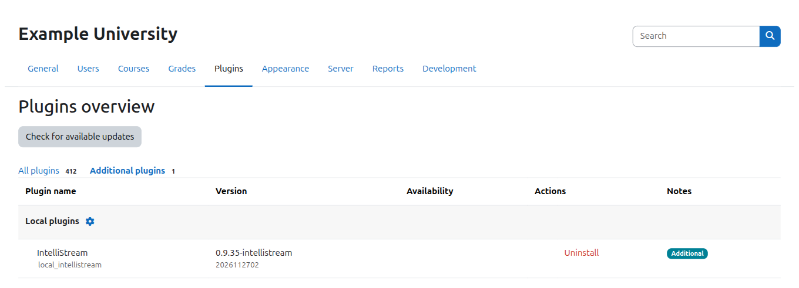
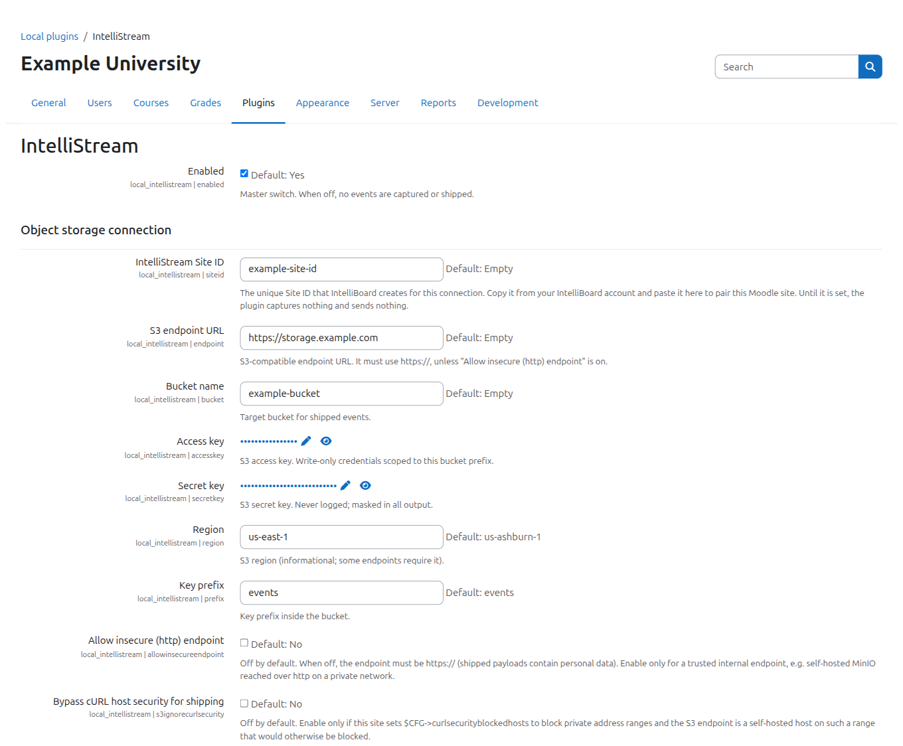
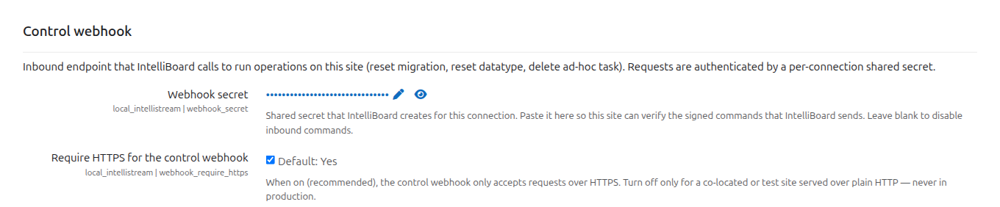
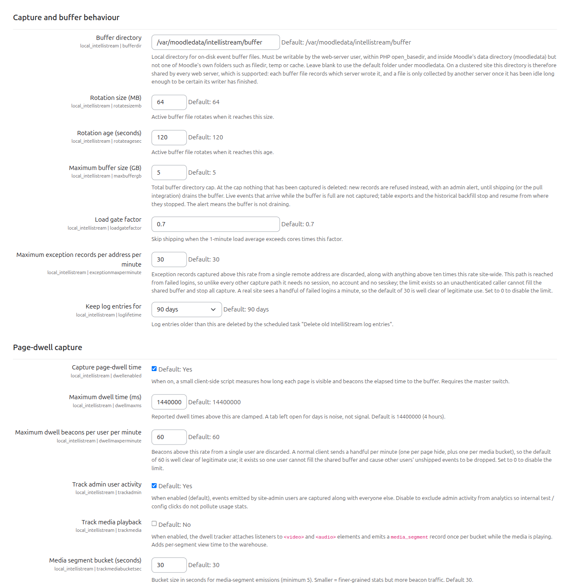
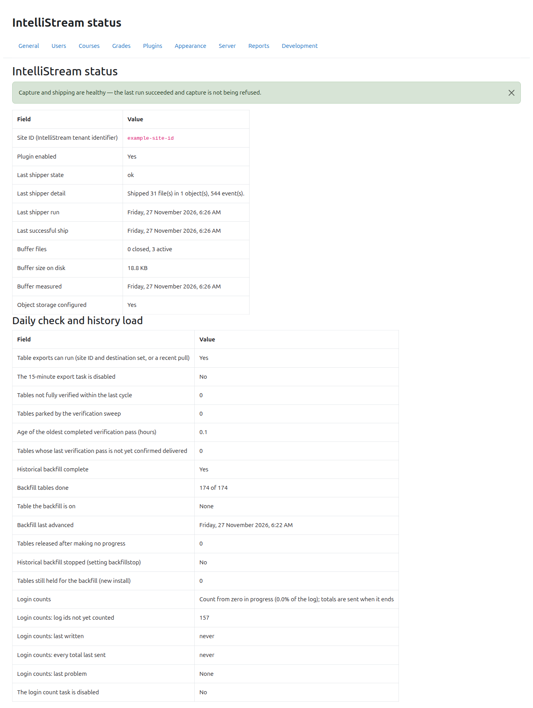
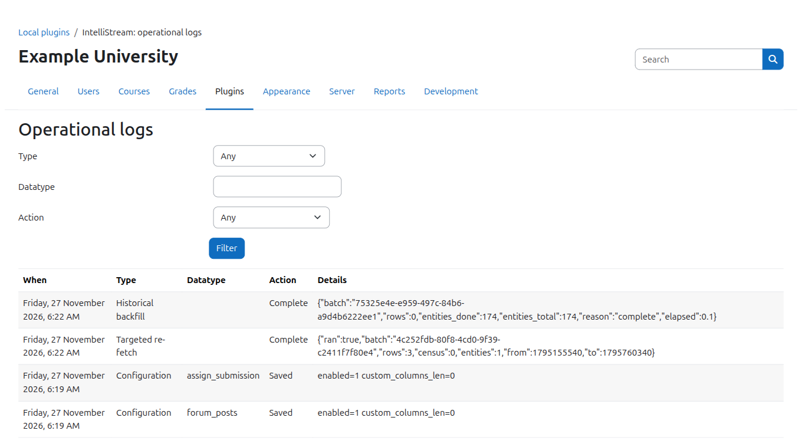
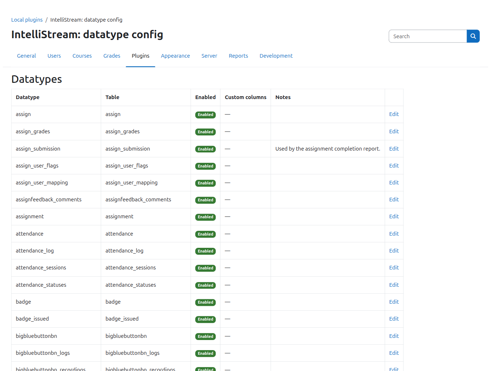
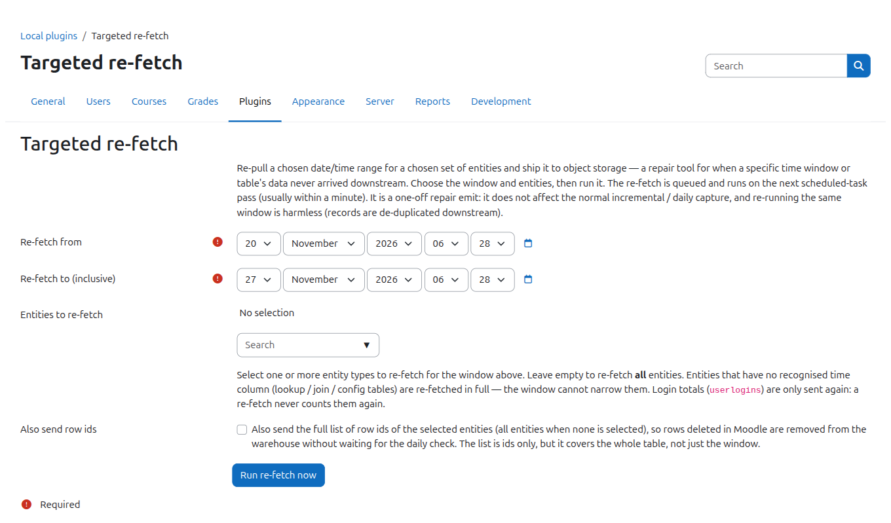
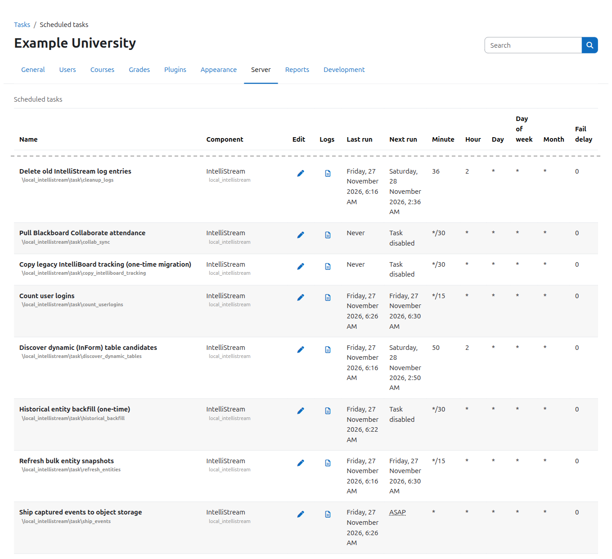

# IntelliStream for Moodle: administrator guide

This guide describes what the IntelliStream plugin (`local_intellistream`) does, how to
connect it to IntelliBoard, and the pages and tools it adds to Moodle. The screenshots
show Moodle 5.1 with the Boost theme. On other Moodle versions the pages look slightly
different, but the settings and the steps are the same.

For requirements, installation and upgrade notes, see the [README](../README.md).

## Contents

- [What the plugin does](#what-the-plugin-does)
- [Before you start](#before-you-start)
- [Connect the plugin to IntelliBoard](#connect-the-plugin-to-intelliboard)
- [Settings](#settings)
- [Check the connection: the status page](#check-the-connection-the-status-page)
- [Operational logs](#operational-logs)
- [Datatype configuration](#datatype-configuration)
- [Targeted re-fetch](#targeted-re-fetch)
- [Scheduled tasks](#scheduled-tasks)
- [Privacy](#privacy)
- [Get help](#get-help)

## What the plugin does

IntelliStream sends the activity and course data of your Moodle site to IntelliBoard.
IntelliBoard builds the reports, charts and dashboards from this data. No report is
calculated in Moodle.

The plugin collects three kinds of data:

- **Events.** Each Moodle event (for example a login, a course view, a submission or a
  grade) is written as one record.
- **Page time.** A small script on each page measures how long the user stays on it.
  Media play time can also be measured. Page time is on by default; media play time
  is off by default.
- **Table data.** Rows of Moodle tables (users, courses, enrolments, grades and many
  more). A new installation sends the full history once. After that, the plugin sends
  the changed rows every 15 minutes, and a daily check sends the list of deleted
  records.

The plugin writes these records to a buffer on the Moodle server's disk, and a
scheduled task sends the buffer to storage that IntelliBoard provides. Capture writes no
rows to the Moodle database.

Optional features:

- Attendance import from Blackboard Collaborate.
- The IntelliBoard dashboard inside Moodle, through LTI.

## Before you start

You need:

- An active IntelliBoard subscription.
- Access to your IntelliBoard account, to copy the connection values.
- A Moodle site administrator account.
- The plugin installed. See [Installation](../README.md#installation) in the README.

After the installation, the plugin is listed under _Site administration > Plugins >
Plugins overview_.

## Connect the plugin to IntelliBoard

### Step 1: Copy the values from IntelliBoard

In your IntelliBoard account, open the connection for your Moodle site. The panel
**Connect your Moodle site** shows the values for the plugin, each with a **Copy**
button:

| Value in IntelliBoard | Setting in Moodle |
|---|---|
| Site ID | IntelliStream Site ID |
| Endpoint | S3 endpoint URL |
| Region | Region |
| Bucket | Bucket name |
| Access Key | Access key |
| Secret Key | Secret key |
| Webhook Secret | Webhook secret |

If your account has no connection for your Moodle site yet, contact IntelliBoard at
helpdesk@intelliboard.net.

### Step 2: Enter the values in Moodle

1. Go to _Site administration > Plugins > Local plugins > IntelliStream_.
2. Enter the **IntelliStream Site ID**.
3. Under **Object storage connection**, enter the **S3 endpoint URL**, **Region**,
   **Bucket name**, **Access key** and **Secret key**.
4. Under **Control webhook**, enter the **Webhook secret**.
5. Make sure that **Enabled** is selected, then select **Save changes**.

### Step 3: Check the connection

Open the **IntelliStream status** page. The link is at the end of the settings page.
Make sure that the page shows your Site ID. After the next run of the scheduled tasks
(usually within a few minutes), the last shipper state is `ok`.

In IntelliBoard, the connection panel then shows the progress: **Credentials
configured**, **First data received**, **Receiving data** and **Reports ready**.

## Settings

The settings page has these sections, in this order. Each setting has a description on
the page.

| Section | What it controls |
|---|---|
| Object storage connection | Where the data is sent. |
| Control webhook | Signed commands from IntelliBoard, for example a targeted re-fetch or a reset of a table's export. |
| Capture and buffer behaviour | The buffer location, file rotation, size limit and load limit, the limit for failed-request records, and how long log entries are kept. |
| Page-dwell capture | Page time, media time, and whether the activity of site administrators is captured. |
| Bulk entity export | Table export, batch size and the daily check. |
| Payload encryption (in transit) | Leave this off. When it is on, records are held in the buffer and are not sent. |
| Blackboard Collaborate API (attendance) | Optional attendance import. |
| IntelliBoard Pro LTI launch | Optional dashboard in Moodle. |

The endpoint must use `https://`. **Allow insecure (http) endpoint** permits plain
`http://`; it is off by default and is meant only for a trusted internal endpoint.

## Check the connection: the status page

The **IntelliStream status** page shows whether capture is enabled, the Site ID, the
state of the last send run, the buffer contents, and the progress of the historical
load and of the daily check.

Use this page first when data does not arrive in IntelliBoard.

## Operational logs

_Site administration > Plugins > Local plugins > IntelliStream: operational logs_ lists
the plugin's own log entries: table exports, configuration changes, the historical
backfill, targeted re-fetches and the copy of legacy IntelliBoard tracking. Filter the
list by type, datatype and action.

Log entries are deleted after the period set in **Keep log entries for** (default 90
days). The task **Delete old IntelliStream log entries** does this every day.

## Datatype configuration

_Site administration > Plugins > Local plugins > IntelliStream: datatype config_ lists
the tables that the plugin exports, and shows which ones are enabled.

## Targeted re-fetch

_Site administration > Plugins > Local plugins > Targeted re-fetch_ sends the data of a
chosen time window again, for one or more tables. Use it when the data of a specific
period or table did not arrive in IntelliBoard.

1. Set **Re-fetch from** and **Re-fetch to (inclusive)**.
2. Select the tables in **Entities to re-fetch**, or leave it empty for all tables.
3. Select **Run re-fetch now**.

The re-fetch runs with the next scheduled task run, usually within a minute. Running the
same window again is harmless: IntelliBoard removes duplicate records.

## Scheduled tasks

The plugin sends data only through its scheduled tasks, so cron must run.

| Task | Default schedule | Enabled by default |
|---|---|---|
| Ship captured events to object storage | Every minute | Yes |
| Refresh bulk entity snapshots | Every 15 minutes | Yes |
| Count user logins | Every 15 minutes | Yes |
| Discover dynamic (InForm) table candidates | Daily at 02:50 | Yes |
| Delete old IntelliStream log entries | Daily, random time | Yes |
| Historical entity backfill (one-time) | Every 30 minutes | No |
| Copy legacy IntelliBoard tracking (one-time migration) | Every 30 minutes | No |
| Pull Blackboard Collaborate attendance | Every 30 minutes | No |

Keep **Refresh bulk entity snapshots** enabled. It is the only task that exports
tables.

## Privacy

The plugin implements the Moodle Privacy API. It declares the data that it sends to
IntelliBoard, and it exports and deletes the personal data that is still on the site:
its own tables and the records still in the buffer.

Data that was already sent to IntelliBoard is not removed by a Moodle deletion request.
To remove it, contact IntelliBoard at helpdesk@intelliboard.net. The
[README](../README.md#privacy) lists the known limits.

## Get help

- Bugs and feature requests: the
  [issue tracker](https://github.com/intelliboard-inc/moodle-local_intellistream/issues).
- Help with your IntelliBoard account or the connection: helpdesk@intelliboard.net.
